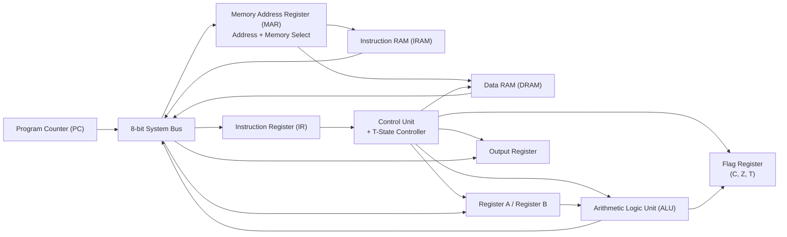

```
     █████╗     ██████╗ ██╗████████╗
    ██╔══██╗    ██╔══██╗██║╚══██╔══╝
    ╚█████╔╝    ██████╔╝██║   ██║
    ██╔══██╗    ██╔══██╗██║   ██║   
    ╚█████╔╝    ██████╔╝██║   ██║   
     ╚════╝     ╚═════╝ ╚═╝   ╚═╝   
```
 
# 8-Bit Harvard Architecture CPU
### Designed in Verilog HDL — Multi-Cycle • Custom ISA • FPGA-Ready

[](LICENSE)


<!-- DEMO GIF — record Vivado sim / FPGA running, convert to gif -->


</div>

---

## Table of Contents

- [Overview](#overview)
- [Features](#features)
- [Architecture](#architecture)
- [Architecture Comparison](#architecturecomparison)
- [Data Flow](#dataflow)
- [Instruction Set](#instruction-set)
- [⏱️ Instruction Timing & Microinstruction Table](#InstructionTiming&MicroinstructionTable)
- [Microinstruction Description](#MicroinstructionDescription)
- [Simulation Results](#simulation-results)
- [FPGA Implementation](#fpga-implementation)
- [Getting Started](#getting-started)
- [Project Progress](#project-progress)
- [Roadmap](#roadmap)
- [Statistics](#statistics)
- [Contributing](#contributing)
- [License](#license)


---

## 🚀 Overview

This project implements a fully custom 8-bit Harvard-inspired CPU from scratch in Verilog HDL, designed for FPGA implementation. Inspired by the simplicity of SAP-1, the processor extends the architecture with separate Instruction (IRAM) and Data (DRAM) memories, a 5-stage T-state control sequencer (T0–T4), an enhanced custom ISA, and modular RTL components.

This design also introduces a dedicated T-State Control Module with a custom CLRT (Clear T-State) microinstruction, allowing instructions to terminate immediately after completion instead of always executing all six T-states. By resetting the timing sequencer early, shorter instructions complete in fewer clock cycles, improving execution efficiency while preserving a simple hardwired control architecture.

Unlike a traditional Von Neumann processor, instructions and data are stored in independent memory banks, while a shared 8-bit internal bus efficiently interconnects the CPU modules. A Memory Address Register (MAR) stores both the memory address and memory selection by custom MEM_SEL (memory selection), allowing seamless access to either memory during execution.

The processor features a hardwired Control Unit, Program Counter, Instruction Register, ALU, A/B Registers, Flag Register, and Output Register, working together to execute 16 custom instructions including arithmetic, logic, branching, bitwise count in accumulator, threshold detection, and shift operations. The ALU automatically updates the Carry, Zero, and Threshold flags for conditional execution.

**Operating Mode**

Three operating modes are supported:

-  **Programming Mode** — Load instructions into **IRAM** and data into **DRAM** directly from the FPGA switches.

-  **Execution Mode** — Execute programs starting from address `0x0`, with manual clock control, CPU reset, and automatic termination using the `HLT` instruction while preserving memory contents.

-  **Clock Speed Mode** — Select the CPU clock frequency:
    - `0` → **Slow Mode** (0.5 Hz) for step-by-step observation and debugging.
    - `1` → **Fast Mode** (50 Hz) for faster program execution.
      
-  Hardware Controls

| Control | Function |
|----------|----------|
| **MEM_SEL Switch** | Selects **IRAM** (`0`) or **DRAM** (`1`) during programming. |
| **Address Switches** | Select the 4-bit memory address. |
| **Data Switches** | Provide the 8-bit instruction or data value. |
| **Enter Button** | Stores the selected data into the selected memory address. |
| **CPU Reset Button** | Resets the CPU state while preserving IRAM and DRAM contents. |
| **RAM Reset Button** | Clears both IRAM and DRAM memories. |
| **Run/Clock Enable Switch** | Starts or pauses CPU execution. |

> [!NOTE]
> **Harvard-Inspired Architecture**
>
> This processor follows a **Harvard-inspired architecture** rather than a classical Harvard architecture. It features **separate Instruction RAM (IRAM)** and **Data RAM (DRAM)**, while both memories communicate over a **shared 8-bit system bus**.
>
> This hybrid approach preserves the advantages of separate instruction and data storage while reducing hardware complexity, simplifying bus routing, and minimizing FPGA resource utilization.
---

## 🛠️ Features

| Feature | Description |
|---------|-------------|
| **Harvard Architecture** | Separate instruction RAM (`iram`) and data RAM (`dram`) |
|  **Custom 16-Instruction ISA** | Includes `POPCNT` and `THRESHOLD` (not found in classic SAP-1 designs) |
|  **Multi-Cycle Control Unit** | 5 T-states (T0 Fetch → T1 Fetch → T2/T3/T4 Decode/Execute) |
|  **Condition Flags** | Carry, Zero, Threshold driving conditional jumps (`JC`, `JZ`) |
|  **Dual Seven-Segment Output** | Live output register + program counter display |
|  **In-System RAM Programming** | program instructions/data directly via FPGA switches before execution |
|  **FPGA-Ready** | Targets Xilinx Spartan-7 (`xc7s50csga324-1`) |
---

## Architecture

<!-- ARCHITECTURE BLOCK DIAGRAM — create in diagrams.net -->
<p align="center">

</p>


---
## 🏗️ Architecture Comparison

| Feature | 🖥️ Classical Von Neumann | ⚡ Classical Harvard | 📥 My Harvard-Inspired CPU |
|---------|---------------------------|----------------------|----------------------------|
| **Instruction Memory** | Shared with data | Dedicated | Dedicated **IRAM** |
| **Data Memory** | Shared with instructions | Dedicated | Dedicated **DRAM** |
| **Memory Organization** | Single unified memory | Separate memories | Separate memories |
| **Instruction Bus** | Shared | Dedicated | Shared internal bus |
| **Data Bus** | Shared | Dedicated | Shared internal bus |
| **Instruction Fetch** | Shared memory | IRAM only | IRAM only |
| **Data Access** | Shared memory | DRAM only | DRAM only |
| **Parallel Instruction & Data Access** | ❌ No | ✅ Yes | ❌ No |
| **Instruction Safety** | Code can be overwritten | Code isolated | Code isolated |
| **Self-Modifying Code** | Possible | Not supported | Not supported |
| **Program Capacity** | Shared with data | Dedicated program memory | Full IRAM reserved for instructions |
| **Data Capacity** | Reduced by program size | Dedicated data memory | Full DRAM reserved for data |
| **Memory Selection Logic** | Address-based | Separate buses | `MEM_SEL` + MAR |
| **Hardware Complexity** | ⭐ Low | ⭐⭐⭐ High | ⭐⭐ Moderate |
| **FPGA Resource Usage** | Low | High | Moderate |
| **Educational Value** | Basic computer architecture | High-performance architecture | Harvard concepts with simplified hardware |

> [!NOTE]
> **Harvard-Inspired Architecture**
>
> This processor follows a **Harvard-inspired architecture** rather than a classical Harvard architecture. It features **separate Instruction RAM (IRAM)** and **Data RAM (DRAM)**, while both memories communicate over a **shared 8-bit system bus**.
>
> This hybrid approach preserves the advantages of separate instruction and data storage while reducing hardware complexity, simplifying bus routing, and minimizing FPGA resource utilization.


---
## Data Flow

---

## Instruction Set

| Opcode | Mnemonic    | Hex   | Description                                  |
|:------:|:------------|:-----:|:----------------------------------------------|
| 0000   | `NOP`       | 0x0   | No operation                                  |
| 0001   | `LDA`       | 0x1   | Load A from data RAM address                  |
| 0010   | `STA`       | 0x2   | Store A to data RAM address                   |
| 0011   | `ADD`       | 0x3   | A = A + dRAM[addr]                            |
| 0100   | `SUB`       | 0x4   | A = A − dRAM[addr]                            |
| 0101   | `LDI`       | 0x5   | Load immediate 4-bit value into A              |
| 0110   | `JMP`       | 0x6   | Unconditional jump                             |
| 0111   | `JC`        | 0x7   | Jump if carry flag set                         |
| 1000   | `JZ`        | 0x8   | Jump if zero flag set                          |
| 1001   | `OUT`       | 0x9   | Output A to 7-segment display                  |
| 1010   | `POPCNT`    | 0xA   | Count set bits in A                            |
| 1011   | `AND_OP`    | 0xB   | A = A & dRAM[addr]                             |
| 1100   | `OR_OP`     | 0xC   | A = A \| dRAM[addr]                            |
| 1101   | `THRESHOLD` | 0xD   | Set threshold flag if popcount(A) ≥ 5          |
| 1110   | `SHL`       | 0xE   | Shift A left by 1                              |
| 1111   | `HLT`       | 0xF   | Halt execution                                 |

---

## ⏱️ Instruction Timing & Microinstruction Table


Each instruction executes across up to 5 T-states:

```
T0 — Fetch:    PC  -----> BUS -----> MAR
T1 — Fetch:    RAM -----> BUS -----> IR        (PC increments)
T2 — Decode:   opcode-dependent micro-op begins
T3 — Execute:  operand fetch / ALU input staging
T4 — Execute:  ALU result written back, flags updated
```
<br>

> [!TIP]
> **Conditional Branch Instructions**
>
> - 🔀 **`JC` (Jump if Carry):** The jump is performed **only when the Carry Flag (`CF`) is set (`CF = 1`)**.
> - 🎯 **`JZ` (Jump if Zero):** The jump is performed **only when the Zero Flag (`ZF`) is set (`ZF = 1`)**.

<br>

| Opcode | Mnemonic | T0 | T1 | T2 | T3 | T4 |
|:-----:|:---------|:---|:---|:---|:---|:---|
| `0x0` | **NOP** | `CO MI` | `RO II CE` | `CLR_T` | — | — |
| `0x1` | **LDA** | `CO MI` | `RO II CE` | `IO MI MEM_SEL` | `RO AI CLR_T` | — |
| `0x2` | **STA** | `CO MI` | `RO II CE` | `IO MI MEM_SEL` | `AO DRI CLR_T` | — |
| `0x3` | **ADD** | `CO MI` | `RO II CE` | `IO MI MEM_SEL` | `RO BI` | `EO FE AI FI CLR_T` |
| `0x4` | **SUB** | `CO MI` | `RO II CE` | `IO MI MEM_SEL` | `RO BI` | `EO FE AI FI CLR_T` |
| `0x5` | **LDI** | `CO MI` | `RO II CE` | `IO AI CLR_T` | — | — |
| `0x6` | **JMP** | `CO MI` | `RO II CE` | `IO J CLR_T` | — | — |
| `0x7` | **JC** | `CO MI` | `RO II CE` | `IO J CLR_T*` | — | — |
| `0x8` | **JZ** | `CO MI` | `RO II CE` | `IO J CLR_T*` | — | — |
| `0x9` | **OUT** | `CO MI` | `RO II CE` | `AO OI CLR_T` | — | — |
| `0xA` | **POPCNT** | `CO MI` | `RO II CE` | `EO FE AI FI CLR_T` | — | — |
| `0xB` | **AND** | `CO MI` | `RO II CE` | `IO MI MEM_SEL` | `RO BI` | `EO FE AI FI CLR_T` |
| `0xC` | **OR** | `CO MI` | `RO II CE` | `IO MI MEM_SEL` | `RO BI` | `EO FE AI FI CLR_T` |
| `0xD` | **THRESHOLD** | `CO MI` | `RO II CE` | `EO FE AI FI CLR_T` | — | — |
| `0xE` | **SHL** | `CO MI` | `RO II CE` | `EO AI FI CLR_T` | — | — |
| `0xF` | **HLT** | `CO MI` | `RO II CE` | `HLT_1` | — | — |


> [!NOTE]
> **Optimized Instruction Timing with `CLR_T`**
>
> Unlike the original **SAP-1** architecture, where every instruction always consumes **6 T-states**, this processor features a dedicated **T-State Control Module** with the custom **`CLR_T`** microinstruction. `CLR_T` resets the timing sequencer immediately after an instruction completes, eliminating unnecessary execution cycles.
>
> **Execution time is therefore variable based on instruction complexity:**
> - ⚡ **3 T-states:** `NOP`, `LDI`, `JMP`, `JC`, `JZ`, `OUT`, `POPCNT`, `THRESHOLD`, `SHL`, `HLT`
> - 📦 **4 T-states:** `LDA`, `STA`
> - ➕ **5 T-states (maximum):** `ADD`, `SUB`, `AND`, `OR`
>
> This optimization reduces clock cycles, improves overall execution efficiency, and retains the simplicity of a **hardwired control unit** without increasing architectural complexity.

---

## 📖 Microinstruction Description

| Control Signal | Description |
|:--------------:|-------------|
| **CO** | Enables the **Program Counter (PC)** to place its address onto the shared system bus. |
| **MI** | Loads the value on the bus into the **Memory Address Register (MAR)**. |
| **RO** | Enables the selected memory (**IRAM** or **DRAM**) to place its data onto the shared bus. |
| **II** | Loads the instruction from the bus into the **Instruction Register (IR)**. |
| **CE** | Increments the **Program Counter (PC)** to point to the next instruction. |
| **IO** | Places the **operand field** (lower 4 bits) of the Instruction Register onto the bus (zero-extended to 8 bits). |
| **AI** | Loads the value on the bus into **Register A (Accumulator)**. |
| **BI** | Loads the value on the bus into **Register B**, used as the second ALU operand. |
| **AO** | Enables **Register A** to place its contents onto the shared bus. |
| **BO** | Enables **Register B** to place its contents onto the shared bus *(reserved for future use in the current design).* |
| **EO** | Enables the **ALU output** to drive the shared system bus. |
| **FE** | Enables the ALU's **special function operations**, such as **POPCNT** and **THRESHOLD**. |
| **OI** | Loads the value on the bus into the **Output Register** for display on the seven-segment display. |
| **DRI** | Writes the value on the bus into the selected **Data RAM (DRAM)** location. |
| **J** | Loads the Program Counter with the address on the bus to perform a **jump** operation. |
| **FI** | Updates the **Flag Register** (Carry, Zero, and Threshold flags) using the ALU result. |
| **MEM_SEL** | Selects the active memory bank: **0 = Instruction RAM (IRAM)**, **1 = Data RAM (DRAM)**. |
| **CLR_T** | Clears the **T-State Counter**, returning execution to the instruction fetch cycle (**T0**). |
| **HLT_1** | Halts CPU execution by stopping further T-state progression and clock advancement. |
---


## Simulation Results

### All 16 instruction verified waveform


---

## FPGA Implementation

**Target Board:** Xilinx Spartan-7 — `xc7s50csga324-1`

<!-- FPGA HARDWARE PHOTOS -->
<p align="center">


</p>

<p align="center">


</p>

### Resource Utilization

<!-- Paste Vivado utilization report screenshot -->
<p align="center">

</p>

---

## Getting Started

### Prerequisites
- Xilinx Vivado 2025.1 (or compatible)
- Spartan-7 FPGA board (`xc7s50csga324-1`) — or simulate without hardware

### Simulation

```bash
# Open the project in Vivado
open_project 8_bit.xpr

# Run behavioral simulation
launch_simulation
run 50ms
```

### Synthesis & Implementation

```bash
launch_runs synth_1 -jobs 10
launch_runs impl_1 -jobs 10
launch_runs impl_1 -to_step write_bitstream -jobs 10
```

### Programming the FPGA

1. Connect your board via JTAG
2. Open Hardware Manager
3. Program device with generated `.bit` file
4. Use `prog_mode` / `prog_we` switches to load a program into RAM
5. Toggle `clk_enable` to run

---

## Example Programs

**`programs/addition.asm`**
```asm
LDI  1        ; A = 1
LDI  3        ; A = 3
ADD  [1]      ; A = A + dRAM[1]
OUT           ; display result
HLT
```

**`programs/threshold.asm`**
```asm
LDI  15       ; A = 0xF
THRESHOLD     ; set threshold flag if popcount(A) >= 5
OUT
HLT
```

**`programs/popcnt.asm`**
```asm
LDI  15       ; A = 0xF (1111)
POPCNT        ; A = number of 1-bits
OUT
HLT
```

---


## Project Progress

```
CPU Core         ██████████ 100%
ALU              ██████████ 100%
Memory           ██████████ 100%
Control Unit     ██████████ 100%
FPGA Testing     ██████████ 100%
Assembler        ██░░░░░░░░  20%
```

---

## Roadmap

**Version 1.0**
- ✅ Harvard Architecture
- ✅ Custom ALU (8 operations)
- ✅ FPGA deployment
- ✅ Dual seven-segment output
- ✅ Conditional jumps with flags

**Version 2.0**
- ⬜ Stack Pointer
- ⬜ `CALL` / `RET` instructions
- ⬜ UART communication
- ⬜ Interrupt handling
- ⬜ Pipelined datapath
- ⬜ Custom assembler / toolchain

---

## Statistics

| Metric              | Value             |
|----------------------|-------------------|
| Lines of Verilog      | 3000+             |
| Modules               | 17                |
| Instructions          | 16                |
| ALU Operations        | 8                 |
| Clock Cycles per Instr| Up to 5 (T0–T4)   |
| Architecture           | Harvard           |
| Target FPGA            | Xilinx Spartan-7  |
| Toolchain               | Vivado 2025.1     |

---

## Contributing

Contributions, bug reports, and feature suggestions are welcome. See [CONTRIBUTING.md](CONTRIBUTING.md) for guidelines.

---

## License

This project is licensed under the MIT License — see [LICENSE](LICENSE) for details.

---

<div align="center">

**Built with Verilog HDL — From Gates to a Working Processor**

</div>
